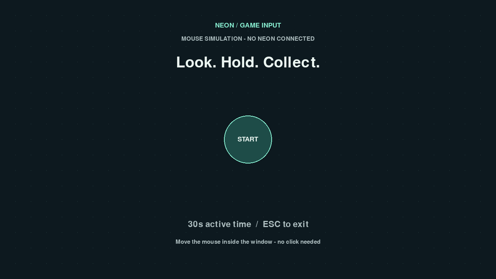

# Neon Game Input

[中文](README.md) · [Integration guide](docs/INTEGRATION.md)

A small toolkit for **Pupil Labs Neon → canvas coordinates → in-game cursor → dwell interaction**.
Independent of the original Lingnan Starry Night game. The core has no third-party dependencies.
Neon, Pygame and the local browser bridge are optional extras. This is an unofficial community project.



## Run without hardware

Python 3.11+, with Python 3.12 recommended for the tested Windows environment:

```sh
python -m venv .venv
# Windows: .venv\Scripts\activate
# macOS/Linux: source .venv/bin/activate
python -m pip install -e ".[demo]"
neon-game --mode mouse
```

Hover over START for 0.6 seconds, then collect the circles by dwelling. Look away after each activation
to rearm. A round lasts 30 seconds of valid input time. Lost focus or tracking pauses the timer.
After the round, dwell on AGAIN. Press Escape to exit. Mouse simulation is visibly labeled and never
connects to or pretends to be Neon.

## Real Neon

```sh
python -m pip install -e ".[neon,demo]"
neon-game --mode neon --fullscreen
# If mDNS discovery is unavailable (replace the example address):
neon-game --mode neon --address 192.0.2.1 --port 8080
```

Connect Neon to its Companion, enable live streaming, and put the computer and Companion on the same
LAN. Wear the glasses and keep all four markers visible to the scene camera. This implementation
requires Companion; it does not provide direct-USB gaze inference or control the OS mouse.

## Browser demo

```sh
python -m pip install -e ".[browser]"
neon-game-web --mode mouse
# With hardware, install the neon extra and use --mode neon.
```

Open `http://127.0.0.1:8765`. Rendering, scoring and game logic run in the browser. Python serves bundled
assets and, in Neon mode, relays only gaze samples on loopback. No CDN, game-frame streaming, cloud,
or original-game runtime is needed. The loaded mouse demo keeps running without the local server;
real gaze still needs a live bridge and Companion connection. Cross-origin WebSockets are rejected.

## Embed in your game

Use `Surface`, `NeonInput`, `InputMonitor` and `Dwell`; the full minimal runnable integration is
[`examples/minimal_pygame.py`](examples/minimal_pygame.py). `PygameOverlay` renders markers and a cursor
without importing any of the demo game. Custom renderers can use `Surface.marker_rects()` and the
bundled PNGs directly. Coordinates use a top-left canvas origin; off-canvas gaze is not clamped.

The [integration guide](docs/INTEGRATION.md) documents lifecycle, timestamps, invalidation and the
browser wire format. The guides are currently in Chinese; API names, docstrings and examples are English.

## Verify and package

```sh
python -m pip install -e ".[neon,demo,browser,dev]"
python -m unittest discover -s tests -v
node --test tests/browser.test.mjs
python -m build
python tools/package_source.py
```

Official mapper tests process synthetic images and do **not** measure hardware accuracy. This extracted
version still needs its own real-device acceptance run. Platform support beyond the locally tested
Windows/Python 3.12 setup is unverified. See [validation](docs/VALIDATION.md). Node is for tests only.
The Windows lock file captures the tested environment and is not a universal lock file.

## License and privacy

MIT for this project's code; see [LICENSE](LICENSE) and [third-party attribution](THIRD_PARTY.md).
The project does not include university branding, participant data, private device settings or
GazeFollower2. SDK dependencies keep their own licenses. No video, audio, gaze history or scores are
persisted by default; scene frames are mapped locally in memory. This repository is installed from
source; these instructions do not assume a published PyPI package.
