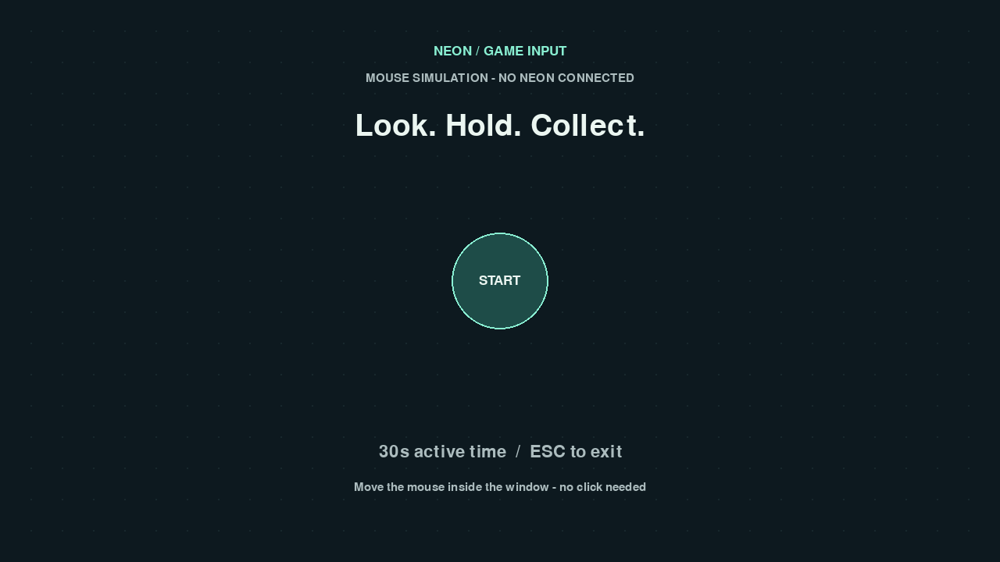

# Neon Game Input

[English](README.en.md) · [接入指南](docs/INTEGRATION.md) · [故障排查](docs/TROUBLESHOOTING.md) · [验证范围](docs/VALIDATION.md)

把 **Pupil Labs Neon → 游戏画布坐标 → 游戏内光标 → 注视停留触发** 接起来的轻量 Python 工具包。

这是一个独立项目：代码、素材、配置、构建和运行均不依赖原来的岭南星夜游戏。
核心库只需要 Python 标准库；Neon、Pygame 和浏览器桥接按需安装。



## 快速试玩：无需 Neon

推荐 Python **3.12**，最低 3.11。在本仓库目录执行：

```powershell
python -m venv .venv
.\.venv\Scripts\Activate.ps1
python -m pip install -e ".[demo]"
neon-game --mode mouse
```

macOS/Linux 激活命令为 `source .venv/bin/activate`。若 PowerShell 不允许激活脚本，直接使用
`.\.venv\Scripts\python.exe -m pip ...` 和 `.\.venv\Scripts\neon-game.exe ...` 即可。

移动鼠标到 START 圆点，停留 0.6 秒开始；继续停留收集圆点。触发后需要移开再瞄准。
默认一局 30 秒有效输入时间，输入丢失或窗口失焦会停止计时。结算后看向 AGAIN 再玩一局。
窗口顶部始终标注 **MOUSE SIMULATION**，此模式不连接眼镜。`Esc` 退出。

Windows 已有虚拟环境时，可双击 `play-mouse.cmd`。示例界面使用英文，方便分享。

## 使用真实 Neon

```powershell
python -m pip install -e ".[neon,demo]"
neon-game --mode neon --fullscreen
```

1. 眼镜接入 Neon Companion，启用实时数据流。
2. Companion 和电脑处于同一个允许设备互通的局域网。
3. 戴好眼镜，让场景相机同时看见画布四角的四个黑白标记。
4. 等待有效映射后，用目光停留触发目标。

默认通过官方 mDNS 发现设备，失败后重试。也可以显式指定 Companion：

```powershell
neon-game --mode neon --address 192.0.2.1 --port 8080 --fullscreen
```

`192.0.2.1` 是文档示例地址，必须替换为你自己的 Companion 地址。
接入需要 Companion；本项目不提供眼镜 USB 直插电脑后的实时注视推理。
这是**游戏内光标**与接入接口，不是任意商业游戏的自动眼控插件，也不会接管系统鼠标。

## 浏览器小游戏

```powershell
python -m pip install -e ".[browser]"
neon-game-web --mode mouse
```

打开终端显示的 `http://127.0.0.1:8765`。真实设备模式：

```powershell
python -m pip install -e ".[neon,browser]"
neon-game-web --mode neon
```

浏览器自行计分、计时和绘制；本机 Python 只提供静态资源和注视样本。无需 CDN，
页面加载完成后鼠标模式即使桥接进程停止也可继续玩。Neon 模式需要保持桥接与 Companion 网络连接。
`/health` 返回 `game_workers: 0`。服务只绑定回环地址，并拒绝跨来源 WebSocket。
它不是公共部署服务；网页配对和远程转发不在本版范围内。

## 接口概览

```python
from neon_game_input import NeonInput, Surface, InputMonitor, Dwell, Circle

surface = Surface(width=1280, height=720, marker_size=160, margin=24)
monitor = InputMonitor()
dwell = Dwell(seconds=0.6)
button = Circle(640, 360, 60)

with NeonInput(surface) as neon:
    # 在你的游戏主循环内，每帧调用以下三行：
    frame = monitor.step(neon.poll(focused=True))
    event = dwell.update("start" if button.contains(frame.position) else None, frame)
    if event == "start":
        print("Start requested")
```

上面只展示单帧接线方式。实际项目须持续执行主循环、传入真实焦点状态，并绘制相同的四角标记。
完整可运行的接入例子：

```powershell
python examples/minimal_pygame.py --mode mouse
python examples/minimal_pygame.py --mode neon
```

详细字段、坐标约定、标记尺寸、生命周期和网页协议见 [INTEGRATION.md](docs/INTEGRATION.md)。

## 目录

```text
src/neon_game_input/  可安装的独立库、可选绘图辅助与两个示例入口
examples/            最小接入示例
docs/                接入、排障、验证记录
tests/               输入、交互、官方映射与本机网页测试
tools/               官方标记生成与源码打包
```

## 验证与构建

```powershell
python -m pip install -e ".[neon,demo,browser,dev]"
python -m unittest discover -s tests -v
node --test tests/browser.test.mjs
python -m build
python tools/package_source.py
```

Node 仅用于 JavaScript 测试，运行游戏不需要 Node。未安装 Neon 依赖时，官方映射测试会明确跳过。
`requirements-windows-py312.lock.txt` 记录此次 Windows/Python 3.12 验证环境；不是跨平台锁文件。
该项目处于 **0.1.0 初始版本**：当前已做的软件检查和仍待实机验证的项目见 [验证记录](docs/VALIDATION.md)。

## 数据与许可证

默认不保存或上传视频、音频、注视轨迹、成绩或设备标识。场景帧仅在本机内存中用于标记定位。
浏览器模式只向同一本机来源传递坐标、样本年龄和状态。

本项目代码使用 [MIT](LICENSE)。使用官方 SDK，独立维护，与 Pupil Labs 无隶属关系。
上游项目、提取来源和标记资源署名见 [THIRD_PARTY.md](THIRD_PARTY.md)。
不包含 GazeFollower2、大学品牌素材、原游戏参与者记录或私人配置。
当前源码提供本地安装方式；README 中不假设本包已发布到 PyPI。
