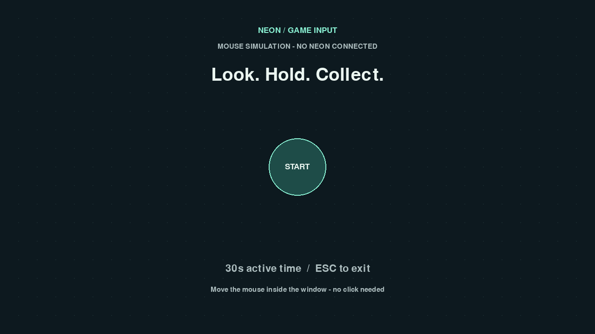
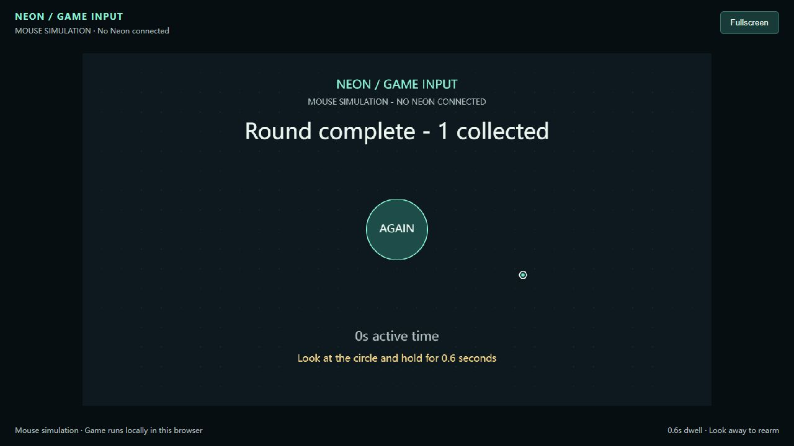

# 0.1.0 验证记录

日期：2026-11-09（Asia/Shanghai）。本记录只描述这个独立项目的检查结果。

## 已完成

| 检查 | 结果与范围 |
| --- | --- |
| 独立环境安装 | 全新 Windows x64 / CPython 3.12.14 虚拟环境安装全部可选依赖，`pip check` 通过 |
| Python 自动测试 | 35 项通过，0 跳过；包括输入有效性、停留、完整模拟游戏、SDK 协议夹具、官方映射与网页桥接 |
| JavaScript 自动测试 | 5 项通过；与 Python 共用输入向量，另查停留去重、重触发和 CSS 坐标反算 |
| 官方映射 | 使用真实官方库处理合成图像；四个标记、三种画布尺寸、透视变换、1.5 倍缩放及空白图像均通过 |
| 桌面渲染 | SDL dummy 驱动下启动主小游戏与最小接入例子，生成并检查 1280×720 截图 |
| 浏览器实际交互 | 内置 Chromium 浏览器中以明确的鼠标模拟完成开始、目标收集（1 分）、30 秒有效时间结算及重新开始；未见控制台错误 |
| 浏览器本地执行 | 页面已加载后停止本机桥接进程，游戏仍能结算并重新开始；未使用游戏画面流 |
| 网页边界 | `/health` 为 `game_workers: 0`；同来源样本连接有效，跨来源连接、错误 Host、源码/父路径访问均被拒绝 |
| wheel 独立安装 | 另一全新虚拟环境先无依赖安装 wheel，核心可导入；再安装 demo/browser extras，用 `python -I` 验证桌面启动、网页资源与标记，`pip check` 通过 |
| 发布素材 | 中英文 README、接入与排障文档、MIT 和上游许可、源码 ZIP 打包脚本、wheel / sdist 构建完成 |
| 原工程隔离 | 独立目录与 Git 仓库；无原游戏导入或运行路径依赖，无校园素材、参与者记录或私人连接配置 |

此次依赖版本见 `requirements-windows-py312.lock.txt`。官方映射会产生上游 NumPy shape
弃用提示，测试通过；没有屏蔽警告或修改安装的第三方源码。

## 截图

桌面截图是**鼠标模拟模式、无设备输入**的启动画面：



网页截图是**鼠标模拟模式**完成一局的结算画面：



## 不能据此宣称已完成

- 本独立版本未进行真实 Neon 佩戴验收；原游戏的实机记录不直接算作本版本验收。
- 未测量真实视线误差、设备到光标的端到端延迟、长时间网络恢复或跨显示器精度。
- 未验证不同 Windows DPI、macOS/Linux 的实际设备运行。CI 已配置，不代表远程 CI 已执行通过。
- 合成图像的约 3 像素映射容差只检查软件几何，不能作为真实佩戴精度。
- 桌面 headless smoke 不覆盖实际显示器、窗口焦点切换和 GPU/驱动组合。

## 硬件验收步骤

1. `neon-game --mode neon --fullscreen`，确认 Companion 实时串流与同网连接。
2. 戴上 Neon，确认四角完整可见；用真实目光开始、收集目标、结算和再玩一局。
3. 暂时遮挡一个标记、移开眼镜或断开网络，确认光标失效、计时暂停、无误触发。
4. 恢复后应先稳定，再继续交互；换窗后同样检查。
5. 使用 `neon-game-web --mode neon` 在浏览器重复，且 `/health` 保持 `game_workers: 0`。
6. 记录系统、包版本、画布物理尺寸和成功/失败项；避免把视频、原始注视或设备身份写进公开报告。

## 重现命令

```powershell
python -m unittest discover -s tests -v
node --test tests/browser.test.mjs
python -m build
python tools/package_source.py
```

独立 wheel 验证（项目根目录）：

```powershell
python -m venv .venv-wheel
.\.venv-wheel\Scripts\python.exe -m pip install ".\dist\neon_game_input-0.1.0-py3-none-any.whl[demo,browser]"
.\.venv-wheel\Scripts\python.exe -I tools/verify_install.py
```
